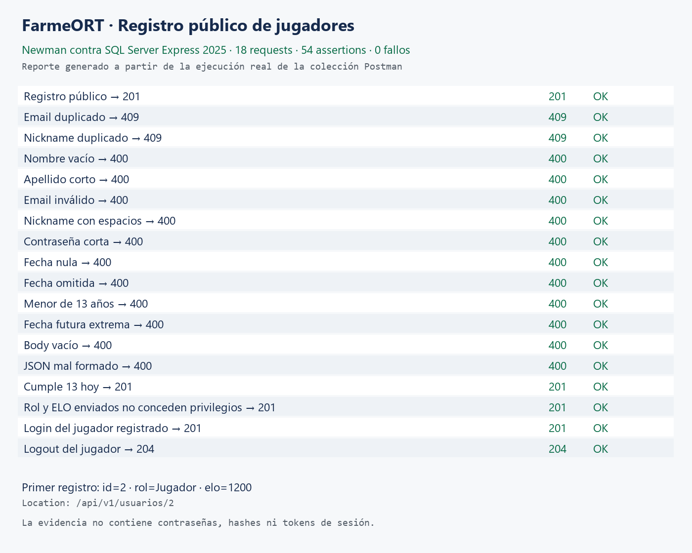
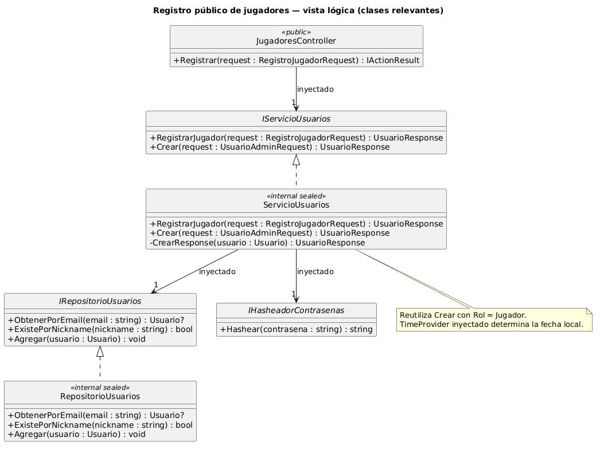
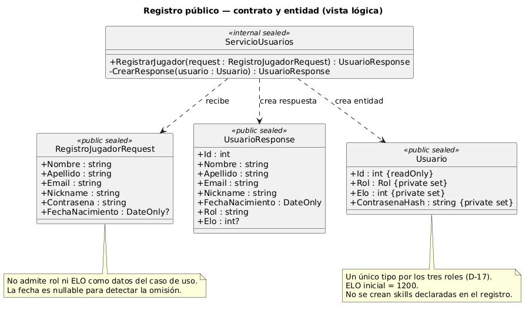

# Evidencia del registro público — punto 1.2

Trabajo en `feature/registro-jugadores`, con el contrato acordado y las instrucciones de `AGENTS.md`
de `origin/develop`, contrastadas con la copia local. No se modificó la configuración obligatoria.

## Ciclos TDD Outside-In

En cada ciclo se ejecutó y mostró el fallo esperado, se guardó el commit RED, se implementó y verificó
el GREEN y se guardó su commit separado. No se reconstruyó la evidencia después de implementar.

| Comportamiento | RED | GREEN |
|---|---|---|
| Controller: 201, Location y llamada al servicio | `9426cf8` | `5450790` |
| Servicio: Jugador, hash, ELO inicial y respuesta | `b75bd69` | `3c915a9` |
| Validación del request público (20 casos) | `3082db1` | `9d87923` |
| Fecha ausente rechazada también por el servicio | `6f7e5b3` | `e4949cb` |
| Fecha futura extrema: validación, sin desbordamiento | `3d8d803` | `48b1904` |
| Conflicto de email surgido al guardar | `003dc37` | `f39f26f` |
| Conflicto de nickname surgido al guardar | `31844a6` | `bac1ff4` |

REFACTOR con tests verdes: `78c3892` reutiliza consultas de unicidad y `8db534d` evita el conflicto
entre whitespace y StyleCop en los filtros `when` expresando las mismas comprobaciones dentro del
catch. No se cambiaron severidades ni se suprimieron reglas.

Los tests que ya pasaron al agregarlos se guardaron sin etapa TDD: `48e7c71` comprueba que otros
errores de base se propagan y `31287bb` documenta reglas heredadas, límites, fecha local y acceso público.
No hacen falta nuevas entidades ni una migración para este caso de uso.

## Verificación local

- `dotnet build ObligatorioDA2.slnx --configuration Release`: correcto.
- `dotnet test ... --settings .runsettings --collect:"XPlat Code Coverage"`: 180 tests, ninguno omitido.
- `dotnet format ObligatorioDA2.slnx --verify-no-changes`: correcto.
- ReportGenerator combinó los cuatro reportes Cobertura: 328/328 líneas y 76/76 ramas cubiertas.

| Assembly | Líneas | Ramas |
|---|---|---|
| FarmeORT.Dominio | 100 % | 100 % |
| FarmeORT.DTOs | 100 % | Sin ramas |
| FarmeORT.Excepciones | 100 % | Sin ramas |
| FarmeORT.IRepositorios | 100 % | Sin ramas |
| FarmeORT.IServicios | 100 % | Sin ramas |
| FarmeORT.Repositorios | 100 % | 100 % |
| FarmeORT.Servicios | 100 % | 100 % |
| FarmeORT.WebAPI | 100 % | 100 % |

Las exclusiones son únicamente las del `.runsettings` obligatorio, incluido contexto, migraciones
y Program. Los mocks de servicio son estrictos y las pruebas de persistencia usan el helper SQLite
existente. La edad usa un reloj fijo y se comprueba también el cambio de fecha UTC/local de Uruguay.

## Postman y SQL Server Express 2025

La colección v2.1 en `Datos/FarmeORT.RegistroJugadores.postman_collection.json` se ejecutó completa
con Newman: **18 requests y 54 assertions aprobadas**, sin fallos. Genera email y nickname nuevos
en cada ejecución, guarda el id y token del jugador y cierra la sesión al terminar.

Incluye registro sin Authorization, duplicados de email/nickname, campos inválidos, fecha omitida y
null, menor de 13, fecha extrema, body vacío y JSON mal formado; además, el límite de 13 años cumplidos,
propiedades adicionales rol/ELO, login del jugador recién creado y logout.

Una consulta posterior en SQL verificó tres usuarios creados por esa ejecución con rol Jugador,
ELO 1200, hash persistido y cero sesiones activas. No se alteraron usuarios existentes ni se aplicaron
migraciones nuevas: la base ya estaba actualizada.

La imagen es un reporte generado desde los resultados reales de Newman, sin contraseñas, hashes ni
tokens. Los JSON detallados de resultados y reportes de cobertura quedan en `local-context/`, ignorados.

## Documentación, UML y revisión

Se mantiene la ficha API en `docs/api/registro-jugadores.md`, las decisiones D-22/D-23 y el diagrama
de clases en `docs/uml/registro-jugadores.puml` y `registro-jugadores-contrato.puml`, separados para
que se lean las relaciones y el contrato. Ambos se renderizaron con PlantUML en Docker y se
inspeccionaron visualmente. El modelo de tablas y la estructura de assemblies no
cambian. La incorporación de estos materiales a los PDFs finales y al video general de Postman
corresponde a los entregables académicos del equipo.

El PR se dirige a `develop` con la plantilla completa. Los resultados de Build, Test y Analysis se
verifican para su revisión publicada y se registran en el PR; la validación local no los sustituye.
La revisión técnica y aprobación de otro integrante y el merge commit quedan a cargo del equipo.

## Declaración de uso de IA

Se utilizó Codex para leer y contrastar requisitos, localizar código con Graphify, preparar tests e
implementación, ejecutar y conservar los ciclos TDD, corregir validación/persistencia, preparar la
colección Postman, documentación, UML y textos del PR, y verificar pruebas y Actions.

Fuentes de contexto: letra oficial del obligatorio, tabla API corregida, decisiones del equipo,
`AGENTS.md` local/remoto, `AGENTS.override.md`, skills `da2-feature`, `da2-tdd`, `da2-git`,
`da2-arquitectura`, `da2-api-rest`, `da2-farmeort-dominio`, `da2-especificacion-api`,
`da2-documentacion`, `da2-postman`, `da2-uml`, `da2-ci` y `da2-revision-pr`, skill Graphify,
`local-context/PR_Y_COMMITS.md`, `FORMA_DE_TRABAJO.md`, PR anteriores y código/tests reales.
Estos materiales privados no se agregaron a Git. Las decisiones previas y el contrato del equipo
se conservaron; el integrante debe revisar, comprender y poder defender el resultado.

Los commits y el PR utilizan exclusivamente la identidad y cuenta del usuario, sin coautorías,
firmas ni trailers de IA. Esta declaración académica no atribuye autoría Git a la herramienta.
